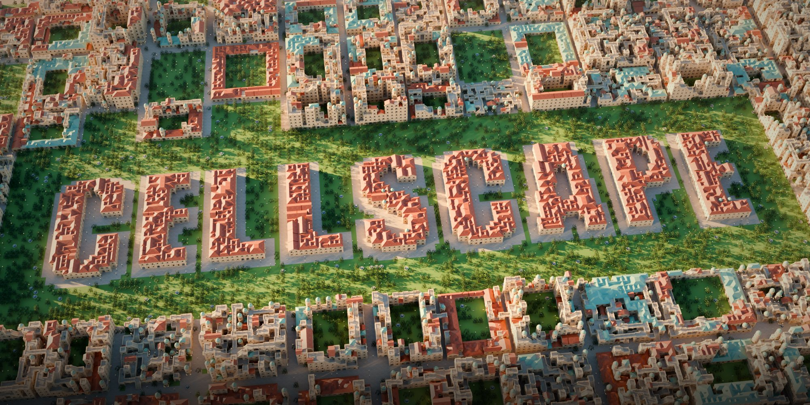

# Cellscape – product page, documentation and web demo

Product page and documentation for **Cellscape**, a Blender add-on that grows buildings with MarkovJunior rules and
walkable, infinite cities with Wave Function Collapse. This repository holds the description, the documentation, the
media and a playable MarkovJunior demo – not the add-on itself.

- **Product page:** [`index.html`](index.html) – https://blenderprocedural.github.io/cellscape/
- **Documentation:** [`docs.html`](docs.html) – https://blenderprocedural.github.io/cellscape/docs.html
- **Web demo (full screen):** [`demo.html`](demo.html) – https://blenderprocedural.github.io/cellscape/demo.html
  (`?model=Castle&seed=42` opens a model and seed directly)

## The web demo

`demo/mj.js` is Cellscape's MarkovJunior interpreter in JavaScript (the rule nodes `one`, `all`, `prl`, `markov`,
`sequence` and `path`), with the same .NET random number generator as the original. A model and seed give exactly
the same grid as Cellscape in Blender. `demo/viewer.js` shows the grid with three.js (loaded from jsDelivr),
`demo/models.js` holds 20 of the 3D models (16 original Cellscape models and four MarkovJunior classics).

## Embedding

All pages work inside an iframe. Links to other pages open in a new tab, and every page posts its height to the
parent window (`{type: "cellscape-height", height}`).

```html
<iframe src="https://blenderprocedural.github.io/cellscape/" width="100%" height="9000" style="border:0" loading="lazy"></iframe>
<iframe src="https://blenderprocedural.github.io/cellscape/demo.html" width="100%" height="680" style="border:0" allow="fullscreen"></iframe>
```

## Credits

MarkovJunior © 2022 Maxim Gumin, MIT licence. three.js © three.js authors, MIT licence. Inter typeface by
Rasmus Andersson, SIL Open Font Licence. See [`LICENSE`](LICENSE).


